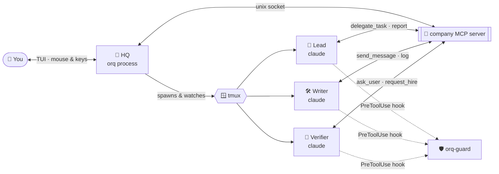

<div align="center">

```
   ██████╗ ██████╗  ██████╗
  ██╔═══██╗██╔══██╗██╔═══██╗
  ██║   ██║██████╔╝██║   ██║
  ██║   ██║██╔══██╗██║▄▄ ██║
  ╚██████╔╝██║  ██║╚██████╔╝
   ╚═════╝ ╚═╝  ╚═╝ ╚══▀▀═╝
```

### Your own virtual company of Claude Code agents — living in tmux, managed from a mouse‑driven terminal UI.

[](https://bun.sh)
[](https://www.typescriptlang.org)
[](https://github.com/vadimdemedes/ink)
[](https://docs.anthropic.com/en/docs/claude-code)
[](https://modelcontextprotocol.io)
[](#-development)

**Hire a team. Give it a goal. Watch it work.**

</div>

---

## ✨ What is orq?

`orq` turns a folder into an **office**. You pick a department (Engineering, Design, Marketing,
Security, Game Studio…), and orq hires a lead plus specialists — each one a real **Claude Code**
session running in its own **tmux** pane. They talk to each other through a shared MCP server,
delegate tasks, report back, and only bother you when something truly needs a human.

You stay in control from a full terminal UI: tabs, buttons, cards, popups and an animated office
where every agent is a little character with its current task written underneath.

```
┌ ⚑ Equipos ─ ☺ Roles ─ ▦ Oficina ─ ▣ Terminales 4 ─ ✉ Mensajes 2 ─ ↺ Sesiones 1 activas ──── 5 h 38% ─┐
│                                                                                                      │
│     ╭───╮            ╭───╮            ╭───╮            ╭───╮                                         │
│     │◕‿◕│  CTO       │•_•│  Backend   │°□°│  QA        │¬_¬│  Reviewer                               │
│     ╰─┬─╯            ╰─┬─╯            ╰─┬─╯            ╰─┬─╯                                         │
│   planning slugify   editing src/str   writing tests    waiting for diff                             │
│                                                                                                      │
│  ✉ cto → backend   [task] Add slugify() in src/str.ts, owned paths: src/str.ts                       │
│  ✉ qa  → cto       [report] 12 tests green, 1 edge case reported                                     │
└──────────────────────────────────────────────────────────────────────────────────────────────────────┘
```

---

## 🧠 How it works



| Piece | What it does |
|---|---|
| **HQ** (`src/hq.ts`) | Starts the run, writes each agent's launch files (system prompt, `settings.json`, MCP config), routes messages, tracks status, compacts idle agents. |
| **company MCP** (`src/mcp-server.ts`) | The office intranet: `team`, `send_message`, `delegate_task`, `report`, `log`, `set_status`, `inbox`, `ask_user`, `set_title`, `request_hire`. |
| **tmux** (`src/tmux.ts`) | Every agent is a real, attachable Claude Code terminal. Detach orq and they keep working. |
| **Hooks** (`src/hook.ts`, `src/orq-guard.ts`) | Forward Claude Code hooks to HQ and block agents from reading orq's own data (other agents' transcripts, secrets). |
| **Statusline** (`src/statusline.ts`) | Records your 5 h / weekly subscription usage and shows it in the top bar. |
| **Library** (`src/library.ts`) | Roles and departments as plain Markdown/YAML you can edit, import and extend. |

---

## 🚀 Features

- 🏢 **Departments out of the box** — 12 ready‑made teams and 60+ roles, from `cto` to `level-designer`.
- 🤖 **Auto team by stack** — orq inspects your repo (`package.json`, `composer.json`, Dockerfiles, CI…) and proposes the right roles, deterministically and without writing a file.
- 🗺 **Auto team by area** — one writer per disjoint set of paths (`src/ui`, `src/*`, `*`), so agents never step on each other's files.
- 💬 **Real collaboration** — leads delegate with goal, context, constraints and owned paths; members report back in ≤10 lines.
- 🙋 **Human in the loop, only when it matters** — agents ask you one question with 2–4 quick‑reply options, recommended first.
- 💸 **Cost profiles** — `max`, `balanced` and `saver`: restricted MCPs, no auto‑memory, per‑role tool sets, cheaper models for read‑only verifiers, compaction at 120k.
- ↺ **Light resume** — a fresh session plus an event‑based summary (~3k tokens, no LLM) instead of replaying the whole transcript. `full` resume is still there if you want it.
- 🔐 **Permission modes** — `auto`, `auto-insecure` and `yolo`, chosen per run.
- 🛡 **Isolation guard** — agents can never read `.orq/` or `~/.orq`, enforced twice (deny rules + hook, which covers Bash too).
- 📦 **Role packs** — import any folder of Claude/OpenCode agent Markdown files, local or over `scp`.
- 🔒 **Private roles** — keep company‑specific agents in a git‑ignored `private/` folder (see below).
- 🖱 **Mouse‑first TUI** — tabs, buttons, scrollable lists, text areas, drafts that survive crashes, light/dark themes and reduced motion.

---

## 📦 Requirements

| Tool | Why |
|---|---|
| [Bun](https://bun.sh) ≥ 1.3 | Runtime, test runner, package manager |
| [tmux](https://github.com/tmux/tmux) | Every agent lives in a tmux session |
| [Claude Code](https://docs.anthropic.com/en/docs/claude-code) (`claude` in `PATH`) | The agents themselves |

## ⚡ Quick start

```sh
git clone https://github.com/teo2peer/Orquestrador-de-tareas.git orq
cd orq
bun install
bun link            # exposes the `orq` command

cd ~/code/my-project
orq                 # open the office here
```

On first run orq seeds `~/.orq` with the default company. Your edits there are never overwritten.

## 🕹 Usage

```text
orq                               open the UI in the current directory
orq --resume                      list sessions (this directory / all)
orq --resume <runId>              resume or reattach a session
orq --resume --last               resume the latest session of this directory
orq import <dir|host:/dir> [pack] import Markdown agents as roles
```

| Tab | |
|---|---|
| ⚑ **Equipos** | Pick a department or build a team (by role or by area), choose profile & permissions, launch. |
| ☺ **Roles** | Browse, filter, edit and create roles. |
| ▦ **Oficina** | The live office: characters, statuses, messages flying around. |
| ▣ **Terminales** | Jump into any agent's real Claude Code terminal. |
| ✉ **Mensajes** | Questions and reports addressed to you, with quick replies. |
| ↺ **Sesiones** | Past and live runs: resume, reattach, inspect. |

---

## 🏬 Default departments

| Department | Lead | Focus |
|---|---|---|
| ⚙ Ingeniería | `cto` | Design, implementation, tests and code review |
| ◆ Producto | `pm` | Requirements, functional analysis and acceptance criteria |
| ⚙ Desarrollo de producto | `pm` | Full squad: PM defines the what, CTO plans, the team ships |
| ✦ Diseño UI/UX | `design-lead` | Research, flows, visual system, copy, accessibility, components |
| ◎ Marketing | `growth-lead` | Positioning, launches, paid ads, PR, funnels, metrics |
| ✎ Creadores de contenido | `growth-lead` | Social, video, blog and email content that captures leads |
| ▣ Sistemas (SysAdmin) | `ops-lead` | Linux, network/DNS, storage, backups, mail, web/TLS, monitoring |
| ◈ Seguridad y riesgo | `secops` | Vulnerabilities and impact analysis |
| ✚ Gabinete de incidencias | `ops-lead` | Incident command, diagnosis, fix, comms and post‑mortem |
| ◉ Estudio de videojuegos | `game-director` | A playable game: design, art, sound, levels, code, QA |
| ☰ Estudio y exámenes | `study-lead` | Notes, glossaries, exam questions and flashcards from your docs |
| ■ Empresa completa | `ceo` | Every area lead plus the technical core |

Every role is a Markdown file with frontmatter (`id`, `name`, `title`, `color`, `accessory`,
`writes`, `description`) followed by its prompt. Every department is a small YAML file.
See [`defaults/`](defaults).

---

## 🔒 Private roles and departments

Company‑specific or confidential agents should never land in this repository. Put them in
`private/`, which is **git‑ignored**:

```text
private/
├── roles/          # *.md roles → copied into ~/.orq/roles
├── departments/    # *.yaml departments → copied into ~/.orq/departments
└── packs/          # raw agent packs you can feed to `orq import`
```

On every start orq copies any file from `private/roles` and `private/departments` that is missing
in `~/.orq`. Existing files are never overwritten, so your edits in the UI are kept.

---

## 🛠 Development

```sh
bun test            # 684 tests, isolated from your real ~/.orq and tmux server
bun run typecheck   # tsc --noEmit
bun start           # run from source
```

> **Smoke testing the UI:** always use a throwaway home:
> `ORQ_SAFE=1 ORQ_HOME=$(mktemp -d) bun src/cli.tsx`.
> With `ORQ_SAFE=1` orq refuses to use your real `~/.orq` and only touches its own tmux sessions.

Measuring cost profiles with real Claude runs: see [`scripts/README-measure.md`](scripts/README-measure.md).

```text
src/
├── cli.tsx          entry point
├── hq.ts            run orchestration
├── mcp-server.ts    the `company` MCP server
├── library.ts       roles, departments, packs
├── stack.ts         auto team by stack
├── areas.ts         auto team by code area
├── resume.ts        light resume summaries
├── orq-guard.ts     isolation guard
└── ui/              Ink components: Teams, Roles, Office, Terminals, Sessions…
```

---

<div align="center">

**orq** — because one Claude is good, but a whole company is better. 🏢✨

</div>
